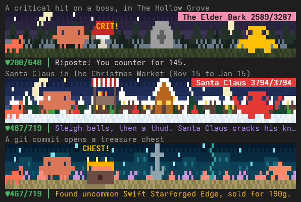

# claude-mods

Three small mods for [Claude Code](https://claude.com/claude-code): a task queue so you can keep
asking while Claude works, a tiny RPG that plays itself while you code, and an emoji on every
session title.

| Mod | In one line |
| --- | --- |
| [**q**](#q-a-task-queue) | Line up prompts; each runs only when the one before it has finished. |
| [**Claude RPG**](#claude-rpg) | Clawd adventures, fights and levels up as you work. |
| [**emoji-title**](#emoji-title) | `fix flaky login test` becomes `🐛 fix flaky login test`. |

## Contents

- [Getting the mods](#getting-the-mods)
- [q: a task queue](#q-a-task-queue)
- [Claude RPG](#claude-rpg)
  - [What you see](#what-you-see)
  - [How the game plays](#how-the-game-plays)
  - [Commands](#commands)
- [emoji-title](#emoji-title)
- [For developers](#for-developers)

## Getting the mods

At a Claude Code prompt, install the ones you want:

```
/plugin install q --marketplace YektaLeblebici/claude-mods
/plugin install clawd-rpg --marketplace YektaLeblebici/claude-mods
/plugin install emoji-title --marketplace YektaLeblebici/claude-mods
```

Answer `y` to add the marketplace, then pick a scope (**user** puts it in every project). Run
`/reload-plugins` and the mod is on.

- **Updating:** `claude plugin marketplace update local-mods`, then
  `claude plugin update <mod>@local-mods` and `/reload-plugins`.
- **Removing:** `claude plugin uninstall <mod>`, or switch it off in `/plugin`.
- **Access:** the repository is private, so installing needs GitHub access to it.

## q: a task queue

Keep talking to Claude while it works. Type `/q <task>` and the task waits its turn: it is sent
only once Claude has **fully finished** the one before, instead of interrupting it. `/q` opens a
pane to reorder, edit and approve tasks, or to hand one off to a parallel copy of Claude in its
own git worktree.

```
 Queue · 2 waiting · default · running #4
 add a task, Enter to queue
 › ▶ #4 you    fix the flaky login test
   · #5 claude dedupe the retry helpers
   · #6 you    bump eslint to v10
 Forks
   ⑂ agent   add a cache  q/add-a-cache-f7   ready
 e edit  d delete  k cursor up  j cursor down  K move up  J move down  r run next …
```

When its turn comes, each task reaches Claude labelled, so both of you know where the queue
stands:

```
[q: queued task q#i4, 0 more after this one]

Let's make a Christmas world that is added to rotation from November 15 to January 15.
```

| You type | What happens |
| --- | --- |
| `/q fix the login test` | Queues the task; sent at once if Claude is idle. |
| `/q /code-review high` | Queues a slash command; it runs when its turn comes. |
| `/q` | Opens or closes the queue pane. |
| `/q default` | Everything you type joins the queue, not just `/q` tasks. |

**Highlights**

- **Parallel forks:** send any task to a background session or subagent in its own worktree;
  finished forks merge back one at a time, between tasks.
- **Claude can suggest follow-ups** with its own `queue_add` tool. A few run on their own, the
  rest wait for your approval, and they are marked `claude` so you can tell them apart.
- **Pauses when it should:** when you press Esc, when Claude needs your answer, or when a merge
  goes wrong.
- **Guards against accidents while you are away:** blocks `git reset --hard` and similar, and
  pushes from tasks Claude queued itself.

The full guide, with every key and safety rule, is in [q/README.md](q/README.md).

## Claude RPG

A tiny RPG that Claude Code plays for you. Your hero, **Clawd**, explores, fights monsters,
finds loot and levels up as you work: every prompt you send and every reply Claude gives moves
the adventure on. It lives in a status line above your prompt, or as an animated pixel-art strip
when you want to watch.



### What you see

**The status line** sits above your prompt: title, level, XP, health, where Clawd is and what
is happening.

```
⚔  Clawd the Newbie · Lv1 ▱▱▱▱▱ HP 38/38 · D1 Whispering Meadow ░░░░░░ · exploring
⚔  Clawd the Doombringer · Lv34 ▰▱▱▱▱ HP 467/719 · D46 The Sunken City of Merrow ░░░░░░ · vs Jelly Specter 98/578
```

**The adventure log** tells the story, with bigger hits in bigger words:

```
Critical! You strike Santa Claus for 1081 (Power Strike).
Santa Claus laughs, "Ho ho ho! Nice, after all," and dusts the snow off his coat. +700 XP, +426g.
Found rare Aetherweave of Vampirism, sold for 226g.
Level up! Clawd is now level 34.
The blacksmith hammers away for 5040g: Segfault, Bane of Pointers +4, Warding Phoenix Feather +8.
Depth 46: The Sunken City of Merrow. Coral has grown through the windows of drowned palaces.
A commit! Clawd pries open a treasure chest: 563g.
```

**The character pane** (`/rpg`) has the full picture:

```
Clawd the Doombringer · Level 34
XP ██░░░░░░░░░░░░ 625/3965
HP █████████░░░░░ 467/719
ATK 280 DEF 247 LUCK 87 CRIT 60%
Gold 126 · Potions 5
🍀 Next tick is lucky

Gear
⚔ Segfault, Bane of Pointers +4 (legendary, power 203+4) · Reflect 15% damage, 10% lifesteal, Lucky effects ×1.5
🛡 Aetherweave of Vampirism +8 (epic, power 131+8) · 10% lifesteal, Reflect 15% damage
💍 Warding Phoenix Feather +8 (epic, power 138+8) · Reflect 15% damage, +DEF

Depth 46 · The Sunken City of Merrow
Progress ▓░░░░░░░░░░░░░ 4/54
vs Jelly Specter ██░░░░░░░░ 98/578

Pets 5/14
● Tiny Dragon Lv1 · +1 ATK (following)
○ Pebble Turtle Lv1 · +1 DEF
○ Slime Lv1 · +5% potion healing
…
```

It goes on with skills, the latest log and achievements. Click a pet, or press its number, to
have it follow Clawd.

### How the game plays

- **Your work drives it.** Each prompt and each Claude reply is one step of the adventure.
- **Luck follows your commands.** A Bash command that succeeds makes the next step lucky (better
  loot, harder hits); one that fails leaves an omen of bad luck.
- **Commits open treasure chests.** A `git commit` opens a chest: a big one at most every 30
  minutes, smaller ones in between.
- **Twelve worlds,** from Whispering Meadow and the Gobbler Caves to the Sunken City of Merrow
  and the Hollow Between, each with its own monsters, two bosses and look.
- **A Christmas world** joins them from November 15 to January 15: the Christmas Market,
  Mistletoe Hollow and the Gingerbread Quarter, with gingerbread brutes, snowman sentries, rogue
  elves, Krampus and Santa Claus himself. Beat Santa and you may win a Little Reindeer or a
  Jolly Snowman.
- **Loot from common to legendary,** with special effects (lifesteal, thorns, crits and more),
  named legendaries such as *Segfault, Bane of Pointers*, and a blacksmith who upgrades your
  gear with spare gold.
- **Fourteen pets,** each giving a small bonus, including four rare wild characters who appear
  with "A wild … appears!" and join you once beaten.
- **Titles as your fame grows,** from Clawd the Newbie through Slayer, Dragonbane and Mythic to
  Clawd the Singularity, plus 15 achievements to unlock.
- **Skills** unlock as Clawd levels up: Power Strike, Second Wind, Riposte, Execute and more.
- **One hero everywhere.** Every Claude Code session on your machine plays the same Clawd.
- **Safe to leave on.** A hiccup in the game never blocks a prompt or a command. It only notices
  *whether* a command succeeded and *whether* it was a commit, never what the command said, so
  secrets in your commands are never stored.

### Commands

| Command | What it does |
| --- | --- |
| `/rpg` | Opens or closes the character pane. |
| `/rpg show` | Status line plus the animated pixel-art strip. |
| `/rpg mini` | Just the status line (the default). |
| `/rpg hide` | Shows nothing; Clawd keeps playing in the background. |
| `/rpg show here` | Add `here` to change only this session; the others keep their view. |
| `/rpg reset` | Starts a new hero (asks you to confirm; `/rpg reset undo` brings the old one back). |

## emoji-title

Gives every Claude Code session title one fitting emoji, so your session list is easier to scan:

```
🐛 Fix flaky login test
⚡ Speed up dashboard queries
🗄️ Upgrade Postgres to 16
🚀 Deploy the new pricing page
📝 Write README for the plugin
```

- **Automatic:** from your second message on, once per session. Titles you set with `/rename`
  get one too.
- **Nearly free:** a built-in keyword list picks most emojis. Only when none fits does it ask
  Claude Haiku, which comes to about $0.004 per 100 conversations.
- **Private:** it reads only the session's title, never your messages, and sends that title to
  Haiku only when no keyword fits.
- **Needs** `python3`.

How it works, what it costs and its limits: [emoji-title/README.md](emoji-title/README.md).

## For developers

Each mod is a folder in this repository, listed in `.claude-plugin/marketplace.json`. To work on
them, add a local checkout as the marketplace; the folder itself then runs, and
`/reload-plugins` picks up your edits:

```sh
claude plugin marketplace add ~/claude-mods
claude plugin install clawd-rpg@local-mods
```

Tests:

```sh
claude plugin test q
claude plugin test clawd-rpg
cd emoji-title && python3 -I tests/test_emoji_title.py
```
